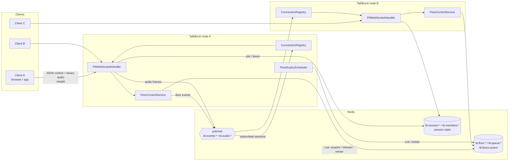

# TalkBurst

A push-to-talk (PTT) group voice service with **floor control**, built with Java 21,
Spring Boot, raw WebSockets and Redis.

In a PTT group, only one person talks at a time. They hold "the floor". TalkBurst
handles that rule for any number of talk groups and any number of service instances:

- **Atomic floor grants.** Every grant, release, renewal and expiry is a single Redis
  Lua script, so even when many clients press the button at once, only one gets the floor.
- **Priority queue with roles.** Requests that arrive while someone is talking are
  queued by `(role priority, arrival time)`. Roles are `DISPATCHER`, `SUPERVISOR`,
  `MEMBER` and `LISTENER` (receive-only).
- **Pre-emption.** A `DISPATCHER` can take the floor from a lower-priority talker,
  who then gets `FLOOR_REVOKED`.
- **Bounded talk bursts.** A grant lasts for `grant-ttl` and the client renews it while
  still talking, up to a hard limit of `max-burst`. A sweeper expires lapsed grants and
  gives the floor to the next person in the queue.
- **Audio relay that checks the floor.** Binary WebSocket frames (opaque audio, e.g.
  PCM or Opus) are passed on to the other participants only while the sender holds the floor.
- **Horizontal scale.** Control events and audio go through Redis pub/sub, one
  channel pair per session, so clients connected to different nodes share one talk group.

## Architecture



Each node subscribes to a session's channels while at least one of its local sockets
is in that session. Each node sends its own events through Redis as well, so every
socket sees events in the same order no matter which node it is on.

### Floor lifecycle

```
            FLOOR_REQUEST
   IDLE ───────────────────────▶ GRANTED(holder, token, expiresAt)
    ▲                               │  │  │
    │  queue empty                  │  │  └─ DISPATCHER request ──▶ REVOKED → GRANTED(dispatcher)
    │                               │  └──── FLOOR_RENEW (≤ max-burst)
    │                               ▼
    └──── RELEASED / EXPIRED / holder disconnects ──▶ next in queue gets GRANTED
```

### Redis layout

| Key | Type | Purpose |
|-----|------|---------|
| `tb:session:{id}` | hash | name, creator, createdAt, capacity (idle TTL) |
| `tb:members:{id}` | hash | `userId -> ROLE\|displayName` |
| `tb:sessions` | set | index of session ids |
| `tb:floor:{id}` | string | `userId\|ROLE\|prio\|token\|grantedAtMs\|expiresAtMs` |
| `tb:queue:{id}` | zset | waiting requests, score = `priority * 1e13 + enqueueMs` |
| `tb:floors:active` | zset | sessionId scored by grant deadline, read by the sweeper |
| `tb:events:{id}` | channel | JSON control envelopes |
| `tb:audio:{id}` | channel | `[u16 len][sender][audio bytes]` |

The scripts in `src/main/resources/lua/` handle every floor state change.

## WebSocket protocol

Connect to `ws://host:8080/ws/ptt?session=<id>&user=<id>&role=<ROLE>&name=<display>&key=<key>`.
`key` is only needed for `DISPATCHER`/`SUPERVISOR` when `TALKBURST_PRIVILEGED_ROLE_KEY` is set.

Client → server (text frames):

| type | fields | effect |
|------|--------|--------|
| `FLOOR_REQUEST` | `requestId?` | press PTT |
| `FLOOR_RELEASE` | `token?` | release PTT (token defaults to the cached one) |
| `FLOOR_RENEW` | `token?` | extend the grant while still talking |
| `FLOOR_CANCEL` | | withdraw a queued request |
| `STATE` | | get a snapshot of the floor, queue and participants |
| `PING` | | keepalive; also refreshes the session idle TTL |

Server → client: `WELCOME`, `PARTICIPANT_JOINED`, `PARTICIPANT_LEFT`, `FLOOR_GRANTED`
(includes `token` **only** for the holder), `FLOOR_QUEUED` (`position`),
`FLOOR_DENIED` (`reason`), `FLOOR_RELEASED`, `FLOOR_RENEWED`, `FLOOR_REVOKED`,
`FLOOR_EXPIRED`, `FLOOR_QUEUE_UPDATED`, `FLOOR_STATE`, `PONG`, `ERROR` (`code`, `message`).

Binary frames sent by the holder go to every other participant. Binary frames from
anyone else are dropped, and the sender gets at most one `NOT_HOLDER` error per second.

## REST API

| Method | Path | |
|--------|------|-|
| `POST` | `/api/sessions` | `{"name","createdBy","maxParticipants?"}` → session + `websocketPath` |
| `GET` | `/api/sessions` | list live sessions |
| `GET` | `/api/sessions/{id}` | session details + participants |
| `GET` | `/api/sessions/{id}/floor` | current holder (without token) and queue |
| `DELETE` | `/api/sessions/{id}` | close a session |
| `GET` | `/actuator/health` | health check |

## How to run

Requirements: JDK 21, Maven 3.9+, and Redis 6.2+ (or Docker).

```bash
# 1. Start Redis
docker compose up -d redis

# 2. (optional) configure
cp .env.example .env    # then edit; export the values or use your IDE's env support

# 3. Run the service
mvn spring-boot:run
```

Then open <http://localhost:8080/> in two browser tabs. Click **Create session** in
one tab, paste the session id into the other, connect both, and hold the button (or
Space) to talk. The demo client sends 16 kHz mono PCM, so you need microphone permission.

To try more than one node, start a second instance on another port against the same Redis:

```bash
PORT=8081 TALKBURST_INSTANCE_ID=node-2 mvn spring-boot:run
```

### Configuration

| Env var | Default | Meaning |
|---------|---------|---------|
| `REDIS_HOST` / `REDIS_PORT` / `REDIS_PASSWORD` | `localhost` / `6379` / empty | Redis connection |
| `TALKBURST_FLOOR_GRANT_TTL` | `PT10S` | length of a grant before it must be renewed |
| `TALKBURST_FLOOR_MAX_BURST` | `PT30S` | hard limit on one talk burst |
| `TALKBURST_FLOOR_MAX_QUEUE` | `16` | maximum waiting requests per session |
| `TALKBURST_SESSION_IDLE_TTL` | `PT2H` | idle sessions expire after this |
| `TALKBURST_SESSION_MAX_PARTICIPANTS` | `64` | capacity ceiling per session |
| `TALKBURST_PRIVILEGED_ROLE_KEY` | empty | shared secret needed to join as DISPATCHER/SUPERVISOR |
| `TALKBURST_ALLOWED_ORIGINS` | `*` | WebSocket allowed origin patterns |

## How to test

```bash
mvn test      # unit tests only: role ranking, floor value codec, protocol codec
mvn verify    # unit tests + integration tests (*IT) — needs a running Docker daemon
```

The integration tests use Testcontainers to start a real `redis:7.2-alpine` and cover:

- **FloorControlServiceIT**: grant/queue order; 24 threads racing for an idle floor with
  exactly one winner; supervisor priority; dispatcher pre-emption; listener denial;
  forged tokens; sweeper expiry and promotion; renewal capped at max-burst; cleanup
  when a participant leaves; cancelling a queued request.
- **PttWebSocketIT**: real WebSocket clients against the running server. Covers the
  token going only to the holder, queueing and promotion, audio reaching every
  participant except the sender, audio from non-holders being dropped, pre-emption,
  8 clients pressing at once, the holder disconnecting, a user reconnecting, unknown
  sessions, and a **second application instance** sharing Redis (floor and audio crossing nodes).

## Notes and limitations

- Identity comes from query parameters, and the only check is the optional shared key
  for privileged roles. In production, put an authenticating gateway or JWT check in
  `PttHandshakeInterceptor`.
- The `tb:floors:active` index is a global key, so this targets standalone or Sentinel
  Redis, not Redis Cluster.
- Audio goes through Redis pub/sub as opaque bytes. That works for voice-sized frames,
  but very large groups would want an SFU for media and TalkBurst for signalling only.
